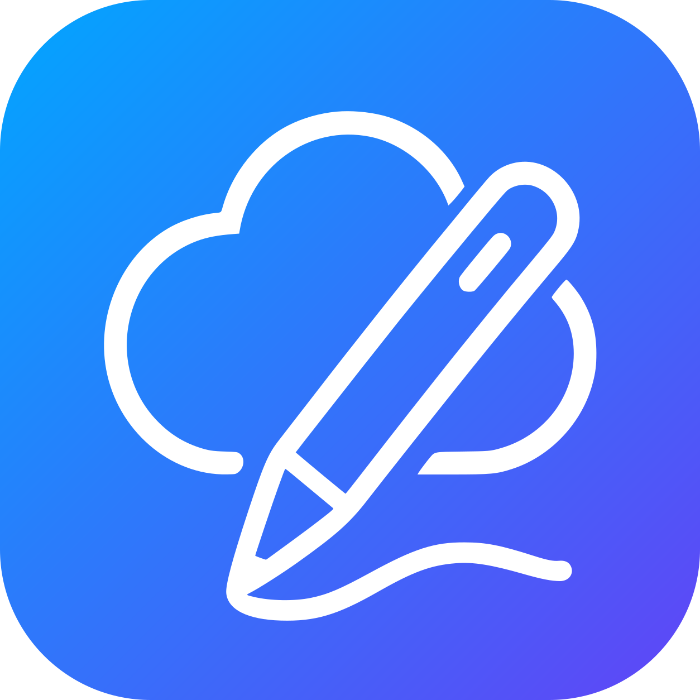
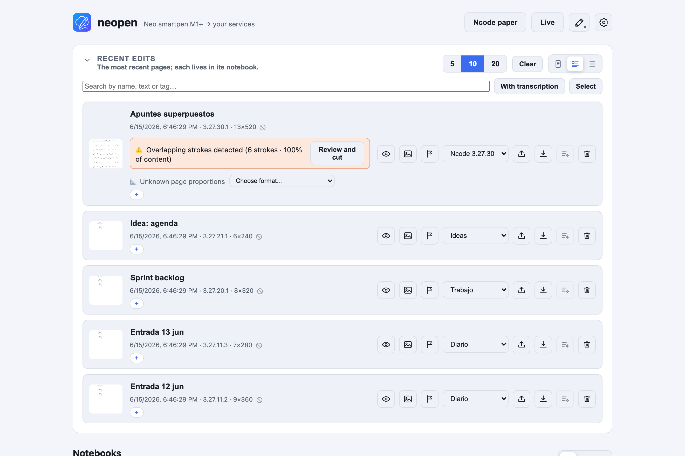

<p align="center">
  
</p>

<h1 align="center">neopen · Android</h1>

<p align="center">
  App Android per al <b>Neo smartpen</b>: captura la teva escriptura per Bluetooth i desa-la al mòbil o sincronitza-la amb un servidor <a href="https://github.com/borborborja/neopen">neopen</a>.
</p>

<p align="center">
  <a href="README.md">English</a> · <a href="README.es.md">Español</a> · <b>Català</b>
</p>

> ⚠️ **Pensat per a Neo smartpen que exposin el protocol Bluetooth Ncode compatible.**

## Què és

La contrapart Android de [**neopen**](https://github.com/borborborja). Connecta amb el Neo smartpen per **Bluetooth LE**, capta la teva escriptura (en directe i des de la memòria offline del boli) i pot:

- **Mode servidor** — puja les pàgines al teu servidor neopen, que les arxiva en quaderns i ho manté tot sincronitzat; o
- **Mode local** — ho desa tot **al mòbil**, sense servidor. Pots vincular un servidor més tard sense perdre res.

Quaderns, safata, transcripció (amb connexió), detecció de traços superposats i finalitzar pàgines funcionen al dispositiu, igual que a la web.

<p align="center">
  
</p>

<p align="center"><sub>L'app web de neopen, on acaben les teves notes. Més captures al repo <a href="https://github.com/borborborja/neopen">neopen</a>.</sub></p>

## Funcions

- 🖊️ **Captura BLE** de Neo smartpen — en directe i bolcant la memòria offline del boli.
- 📴 **Mode local** (sense servidor) o **mode servidor** (sync amb neopen).
- 🗂️ **Quaderns i safata** al dispositiu, organitza i etiqueta.
- ⚠️ **Detecció de traços superposats** amb tall per línia de temps, i **finalitzar full** (segellat de forma permanent en reescriure la mateixa pàgina Ncode).
- 🔤 **Transcripció** via el teu servidor neopen (amb connexió).
- 🔔 **Servei en segon pla** opcional per mantenir el boli connectat.
- 🔒 Contrasenya del servidor **xifrada en repòs** (Android Keystore) i exclosa del backup al núvol.
- 🌍 Traduïda (16 idiomes) amb temes clar/fosc.

## Compilar

1. Obre el projecte a **Android Studio** (o compila per CLI amb **JDK 17**).
2. `minSdk 26`, `targetSdk 34`. Cal un **dispositiu físic** amb BLE (l'emulador no té Bluetooth).
3. Concedeix els permisos de Bluetooth (i notificacions a Android 13+) en arrencar.

```bash
JAVA_HOME=/ruta/al/jdk-17 ./gradlew :neopen:assembleDebug
```

### APK (GitHub Actions)

La CI compila un **APK debug** instal·lable a cada push a `main` i a cada PR:

- **Artifact**: pestanya *Actions* → run → artefacte APK.
- **Release**: en pujar un tag `vX.Y.Z`, l'APK s'adjunta a la release de GitHub.

## Avís legal

Aquesta app és un projecte independent i comunitari. **No està afiliat, autoritzat, avalat ni patrocinat per NeoLAB Convergence Inc.** «Neo smartpen», «Ncode», «N-code» i els noms i logotips relacionats són marques de NeoLAB Convergence Inc. i dels seus titulars respectius, usats aquí només per descriure compatibilitat.

Les constants del protocol BLE es van reconstruir a partir del SDK GPL-3.0 de NeoLAB (no hi ha codi copiat, només valors del protocol). El programari s'ofereix **«tal qual», sense cap garantia**, en la mesura que ho permeti la llei.

## Llicència

[GPL-3.0](LICENSE).
