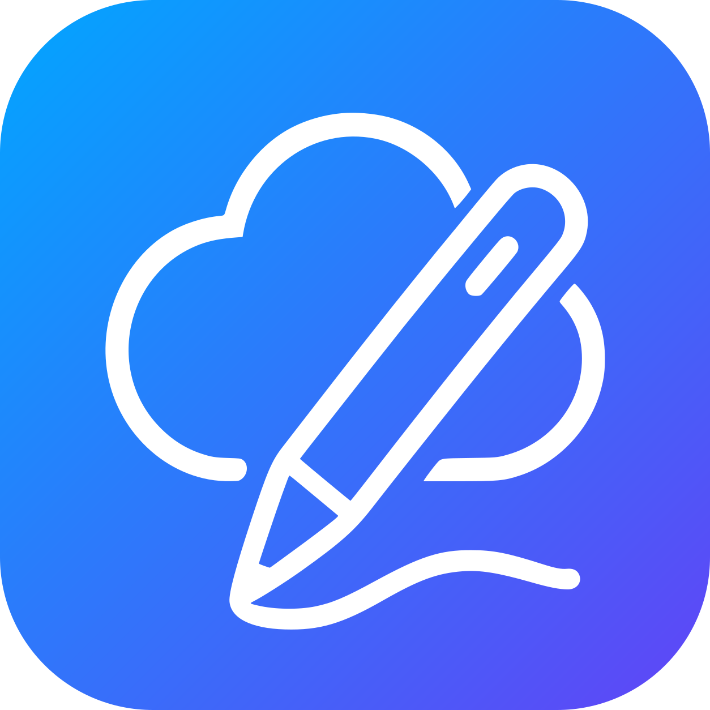
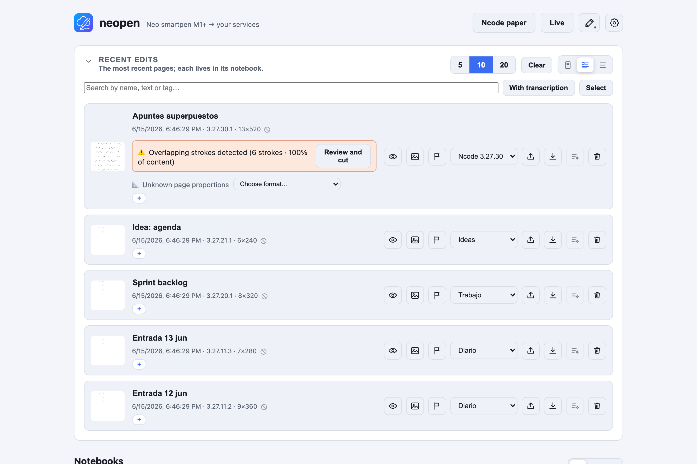

<p align="center">
  
</p>

<h1 align="center">neopen · Android</h1>

<p align="center">
  App Android para el <b>Neo smartpen M1+</b>: captura tu escritura por Bluetooth y guárdala en el móvil o sincronízala con un servidor <a href="https://github.com/borborborja/neopen">neopen</a>.
</p>

<p align="center">
  <a href="README.md">English</a> · <b>Español</b> · <a href="README.ca.md">Català</a>
</p>

> ⚠️ **Probado solo con el Neo smartpen M1+ (NWP-F51).** Otros modelos de boli no se han probado y puede que no funcionen.

## Qué es

La contraparte Android de [**neopen**](https://github.com/borborborja). Conecta con el Neo smartpen por **Bluetooth LE**, capta tu escritura (en vivo y desde la memoria offline del boli) y puede:

- **Modo servidor** — sube las páginas a tu servidor neopen, que las archiva en cuadernos y lo mantiene todo sincronizado; o
- **Modo local** — lo guarda todo **en el móvil**, sin servidor. Puedes vincular un servidor más tarde sin perder nada.

Cuadernos, bandeja, transcripción (con conexión), detección de trazos superpuestos y finalizar páginas funcionan en el dispositivo, igual que en la web.

<p align="center">
  
</p>

<p align="center"><sub>La app web de neopen, donde acaban tus notas. Más capturas en el repo <a href="https://github.com/borborborja/neopen">neopen</a>.</sub></p>

## Funciones

- 🖊️ **Captura BLE** del M1+ — en vivo y volcando la memoria offline del boli.
- 📴 **Modo local** (sin servidor) o **modo servidor** (sync con neopen).
- 🗂️ **Cuadernos y bandeja** en el dispositivo, organiza y etiqueta.
- ⚠️ **Detección de trazos superpuestos** con corte por línea de tiempo, y **finalizar hoja** (sellada de forma permanente al reescribir la misma página Ncode).
- 🔤 **Transcripción** vía tu servidor neopen (con conexión).
- 🔔 **Servicio en segundo plano** opcional para mantener el boli conectado.
- 🔒 Contraseña del servidor **cifrada en reposo** (Android Keystore) y excluida del backup en la nube.
- 🌍 Traducida (16 idiomas) con temas claro/oscuro.

## Compilar

1. Abre el proyecto en **Android Studio** (o compila por CLI con **JDK 17**).
2. `minSdk 26`, `targetSdk 34`. Hace falta un **dispositivo físico** con BLE (el emulador no tiene Bluetooth).
3. Concede los permisos de Bluetooth (y notificaciones en Android 13+) al arrancar.

```bash
JAVA_HOME=/ruta/al/jdk-17 ./gradlew :neopen:assembleDebug
```

### APK (GitHub Actions)

La CI compila un **APK debug** instalable en cada push a `main` y en cada PR:

- **Artifact**: pestaña *Actions* → run → artefacto APK.
- **Release**: al subir un tag `vX.Y.Z`, el APK se adjunta a la release de GitHub.

## Aviso legal

Esta app es un proyecto independiente y comunitario. **No está afiliado, autorizado, respaldado ni patrocinado por NeoLAB Convergence Inc.** «Neo smartpen», «Ncode», «N-code» y los nombres y logotipos relacionados son marcas de NeoLAB Convergence Inc. y de sus respectivos titulares, usados aquí solo para describir compatibilidad.

Se ha **probado solo con el Neo smartpen M1+ (NWP-F51)**; otros modelos no se han probado y puede que no funcionen. Las constantes del protocolo BLE se reconstruyeron a partir del SDK GPL-3.0 de NeoLAB (no hay código copiado, solo valores del protocolo). El software se ofrece **«tal cual», sin ninguna garantía**, en la medida permitida por la ley.

## Licencia

[GPL-3.0](LICENSE).
