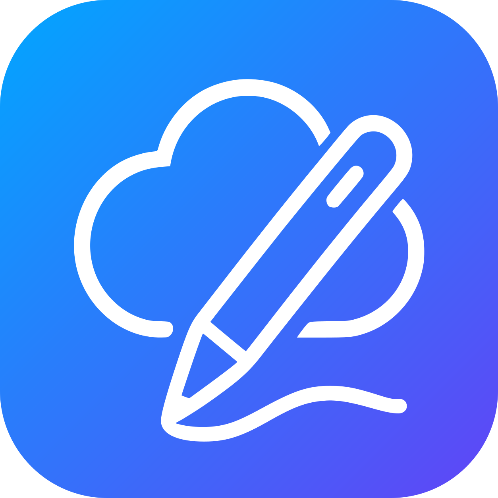
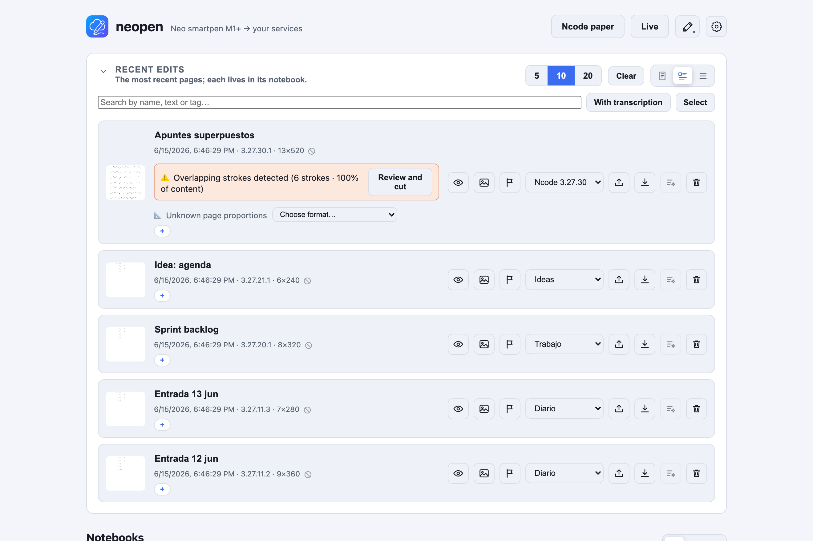

<p align="center">
  
</p>

<h1 align="center">neopen · Android</h1>

<p align="center">
  Android app for the <b>Neo smartpen</b>: capture your handwriting over Bluetooth and keep it on your phone or sync it to a <a href="https://github.com/borborborja/neopen">neopen</a> server.
</p>

<p align="center">
  <b>English</b> · <a href="README.es.md">Español</a> · <a href="README.ca.md">Català</a>
</p>

> ⚠️ **Designed for Neo smartpens that expose the supported Ncode Bluetooth protocol.**

## What it is

The Android counterpart of [**neopen**](https://github.com/borborborja). It connects to the Neo smartpen over **Bluetooth LE**, captures your writing (live and from the pen's offline memory), and either:

- **Server mode** — uploads pages to your neopen server, which files them into notebooks and keeps everything in sync; or
- **Local mode** — keeps everything **on the phone**, no server required. You can link a server later without losing anything.

Notebooks, inbox, transcription (when online), overlapping-stroke detection, and finishing pages all work on-device, mirroring the web app.

<p align="center">
  
</p>

<p align="center"><sub>The neopen web app, where your notes land. More screenshots in the <a href="https://github.com/borborborja/neopen">neopen</a> repo.</sub></p>

## Features

- 🖊️ **BLE capture** of Neo smartpen — live, plus dumping the pen's offline memory.
- 📴 **Local mode** (no server) or **server mode** (sync to neopen).
- 🗂️ On-device **notebooks & inbox**, organize and tag.
- ⚠️ **Overlapping-stroke detection** with timeline cut, and **finish page** (sealed permanently once you rewrite the same Ncode page).
- 🔤 **Transcription** via your neopen server (when online).
- 🔔 Optional **background service** to keep the pen connected.
- 🔒 Server password **encrypted at rest** (Android Keystore) and excluded from cloud backup.
- 🌍 Localized (16 languages) with light/dark themes.

## Build

1. Open the project in **Android Studio** (or build from the CLI with **JDK 17**).
2. `minSdk 26`, `targetSdk 34`. A **physical device** with BLE is required (the emulator has no Bluetooth).
3. Grant Bluetooth (and notifications on Android 13+) permissions on first run.

```bash
JAVA_HOME=/path/to/jdk-17 ./gradlew :neopen:assembleDebug
```

### APK (GitHub Actions)

CI builds an installable **optimized APK** (`neopen.apk`, non-debuggable, R8) on every push to `main` and on PRs. It retains the signing certificate of previous GitHub APKs so existing installations can be updated:

- **Artifact**: *Actions* tab → run → APK artifact.
- **Release**: pushing a tag `vX.Y.Z` attaches the APK to the GitHub release.

## Disclaimer

This app is an independent, community project. It is **not affiliated with, authorized, endorsed by, or sponsored by NeoLAB Convergence Inc.** "Neo smartpen", "Ncode", "N-code" and related names and logos are trademarks of NeoLAB Convergence Inc. and their respective owners, used here only to describe compatibility.

The BLE protocol constants were reconstructed from NeoLAB's GPL-3.0 SDK (no code copied — only protocol values). The software is provided **"as is", without warranty of any kind**, to the extent permitted by law.

## License

[GPL-3.0](LICENSE).
